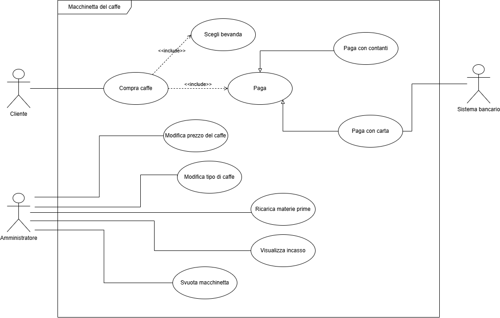
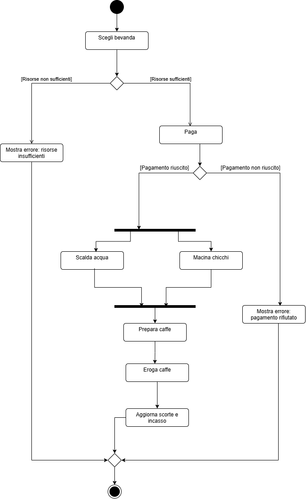
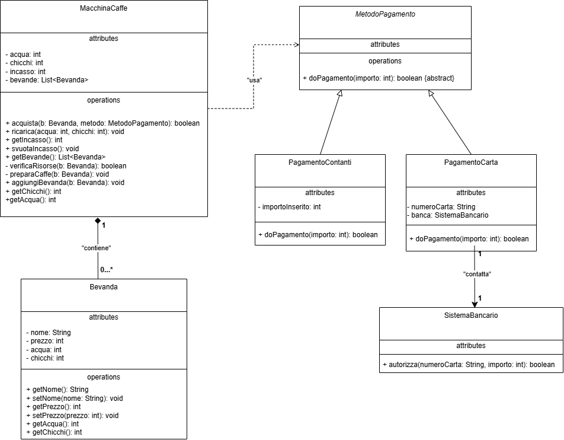

# Coffee Machine (Java)

A small terminal application that simulates a coffee machine, written in Java as a personal project to practice object-oriented programming. The project was designed first with UML diagrams (use case, activity, class diagram) and then implemented following them (forward engineering).

The menu and messages are in Italian.

## Features

**Client**

* Shows the list of drinks with their prices.
* Lets the client choose a drink and pay by **cash** or by **card**.
* Checks that there is enough water and coffee beans before paying, and that the payment succeeds before preparing the drink.
* Prepares the drink (the preparation takes 10 seconds) and updates the supplies and the cash box.

**Administrator**

* Shows the remaining water and coffee beans.
* Shows the money collected.
* Changes the price of a drink.
* Changes the name of a drink.
* Empties the cash box.
* Refills water and coffee beans.

## Project Structure

```text
src
├─ Main.java
├─ modello
│   ├─ Bevanda.java
│   └─ MacchinaCaffe.java
└─ pagamento
    ├─ MetodoPagamento.java
    ├─ PagamentoContanti.java
    ├─ PagamentoCarta.java
    └─ SistemaBancario.java
```

| Class | Purpose |
|-------|---------|
| `Main` | Menus for client and administrator. Reads the input and calls the other classes, it contains no machine logic. |
| `Bevanda` | A drink: name, price, water and beans needed. |
| `MacchinaCaffe` | The machine: supplies, cash box, list of drinks, and the `acquista` method that handles a purchase. |
| `MetodoPagamento` | Abstract class with the `doPagamento` method. |
| `PagamentoContanti` | Cash payment: succeeds if the inserted money is enough. |
| `PagamentoCarta` | Card payment: asks the bank to authorize the payment. |
| `SistemaBancario` | Simulated bank with the `autorizza` method. |

## Diagrams

The design is in the `docs` folder.

**Use case diagram**



**Activity diagram**



**Class diagram**



## OOP Concepts Used

* **Encapsulation:** all attributes are private, and the steps that must not be called from outside (`verificaRisorse`, `preparaCaffe`) are private methods. The only way to get a coffee is `acquista`.
* **Inheritance:** `PagamentoContanti` and `PagamentoCarta` extend the abstract class `MetodoPagamento`.
* **Polymorphism:** `MacchinaCaffe` calls `metodo.doPagamento(...)` without knowing whether it is paying with cash or card.
* **Composition:** the machine contains its drinks (`List<Bevanda>`).
* **Association:** `PagamentoCarta` uses `SistemaBancario` to authorize the payment.

## How to Run

Open the project in IntelliJ IDEA and run `Main`.

Or, from the terminal, in the `src` folder:

```bash
javac Main.java modello/*.java pagamento/*.java
java Main
```

## Example

```text
		 Macchinetta del caffe
1. Cliente
2. Amministratore
0. Esci
1
1. Espresso - 100 centesimi
2. Lungo - 150 centesimi
3. Americano - 120 centesimi
4. Cold Brew - 200 centesimi
5. Ristretto - 50 centesimi

Che bevanda scegli?
```

## Notes

* All amounts are `int` values in cents (1.20 € = 120), to avoid rounding errors with decimals.
* The bank is simulated: it only refuses a card if the card number is empty.
* The data is not saved: when the program closes, supplies, prices, and cash box go back to the initial values.

## Known Limitations

* If a number is expected and the user types something else, the program stops with an error.
* With cash, the change is not given back: the whole inserted amount is not tracked, only the price is added to the cash box.
* In the client menu, the chosen drink number is not checked, so a number outside the list makes the program stop.
* Drink names are read with `Scanner`, so they depend on how the input is read (a name with spaces needs `nextLine`).
